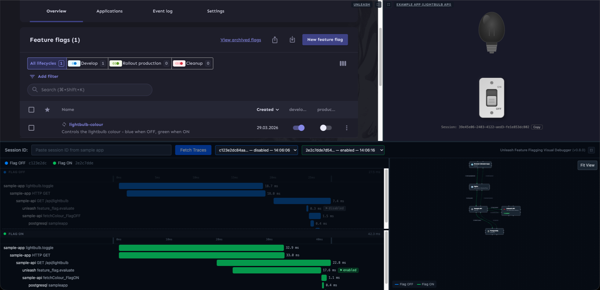
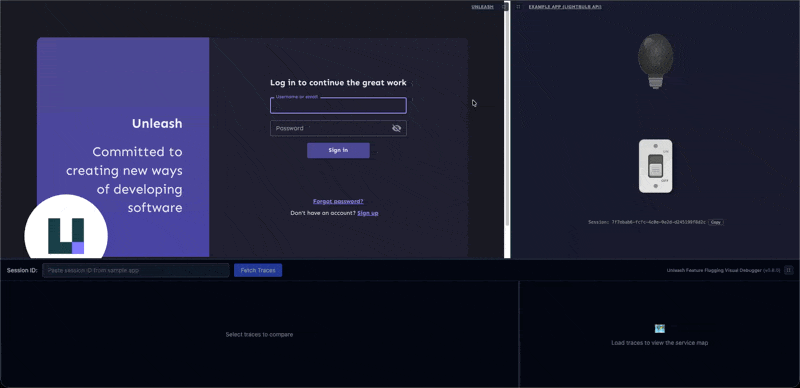

# Feature Flag Visual Debugger

An open-source developer tool that visualises how feature flags affect request execution paths across a full application stack. Uses OpenTelemetry traces to show, side-by-side, what happens when a flag is ON versus OFF — from the reverse proxy down to the database.

This is a **debugging and educational tool**, not a monitoring dashboard.



## Quick Start

```bash
make install        # Install npm dependencies
make example-up     # Start the example infrastructure (Docker Compose)
make dev            # Start the debugger (Vite + Express)
```

Then open your browser at **http://localhost:1337**.

### Demo Flow

1. In the **top-left pane** (Unleash UI at localhost:4242), confirm the `lightbulb-colour` flag is **disabled**. Log in with `admin` / `unleash4all`.
2. In the **top-right pane** (Example App), flip the toggle switch ON. The lightbulb turns **blue**.
3. In Unleash, enable the `lightbulb-colour` flag for the `development` environment.
4. Flip the switch again. The lightbulb turns **green**.
5. Copy the **Session ID** from the sample app and paste it into the **bottom pane** filter. Click **Fetch Traces**.
6. The waterfall renders both traces (blue for flag-OFF, green for flag-ON), and the service map highlights the request path.



## Why Unleash?

[Unleash](https://www.getunleash.io/) is an open-source feature flag management system that can be self-hosted — no SaaS dependency, no vendor lock-in. It has a clean admin UI for toggling flags, a well-documented REST API, and mature SDKs for many languages (including Java, which powers the example API). For a local-first debugging tool, Unleash is the natural fit: it runs as a single Docker container alongside the rest of the stack, and the SDK calls to evaluate flags are real HTTP requests visible in OpenTelemetry traces.

## Why This Debugger?

Feature flags change system behaviour at runtime, but the effects are invisible. A flag might route a request to a different code path, query a different table, or skip an entire service — and you won't see any of this in the flag's admin UI.

Existing observability tools (Jaeger UI, Grafana Tempo) show individual traces but don't help you **compare** what happens when a flag is ON vs OFF. You have to manually open two traces, mentally overlay the waterfalls, and figure out where the paths diverge.

This debugger makes the comparison visual and immediate:
- **Side-by-side waterfalls** with colour-coded paths (blue for OFF, green for ON).
- **Feature flag badges** on spans that evaluated a flag.
- **Service map** highlighting which services were involved in each path.
- **Span details** showing the SQL queries, HTTP calls, and flag evaluation context.

The goal is to answer the question: *"What exactly changes when I flip this flag?"*

## Prerequisites

- **Node.js** 22+
- **Docker** and **Docker Compose** v2
- **Java 21** (only if building the sample API outside Docker)

## Make Targets

| Target              | Description                                         |
|---------------------|-----------------------------------------------------|
| `make install`      | Install npm dependencies for all packages           |
| `make dev`          | Start debugger in development mode (Vite + Express) |
| `make build`        | Production build                                    |
| `make lint`         | Run TypeScript type checking                        |
| `make test`         | Run test suites                                     |
| `make clean`        | Remove build artifacts and node_modules             |
| `make example-up`   | Start the example Docker Compose environment        |
| `make example-down` | Stop and remove the example environment             |
| `make example-logs` | Tail logs from the example environment              |

## Project Structure

```
feature-flag-visual-debugger/
├── Makefile                    # Primary automation interface
├── packages/
│   ├── client/                 # React front-end (Vite + TypeScript + Tailwind)
│   └── server/                 # Express API proxy to Jaeger
├── example/                    # Docker Compose example environment
│   ├── docker-compose.yml
│   ├── sample-app/             # React lightbulb UI with OTel browser SDK
│   ├── sample-api/             # Java Spring Boot API with Unleash + OTel agent
│   ├── init/                   # PostgreSQL seed data + Unleash flag bootstrap
│   ├── nginx/                  # Reverse proxy config
│   └── otel-collector/         # OpenTelemetry Collector config
└── docs/
    ├── dependencies.md         # Dependency justifications
    ├── architecture.md         # Architectural decisions
    └── future-development.md   # Road to 1.0.0
```

## Documentation

- [Dependencies](docs/dependencies.md) — every dependency with justification
- [Architecture](docs/architecture.md) — key architectural decisions
- [Future Development](docs/future-development.md) — road to 1.0.0

## License

- [Apache License, Version 2.0](LICENSE)

## Authors

- [Wojciech Gawroński (afronski)](https://github.com/afronski) (aka [AWS Maniac](https://awsmaniac.com))
