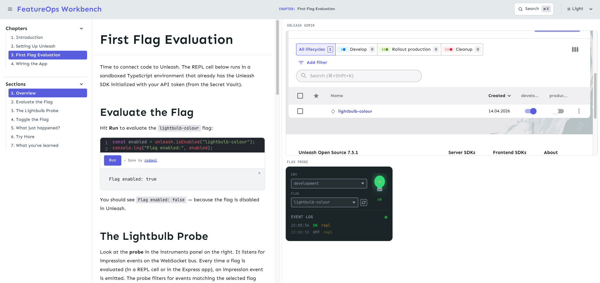

# FeatureOps Workbench

A self-contained, Docker Compose-based interactive workbench for learning feature flagging with [Unleash](https://getunleash.io) and about [FeatureOps](https://featureops.io) practice. 

A narrated, chapter-based website where the reader interacts with live code, a live Unleash instance, and visual probe instruments — all from a single `make all` command. This is a **debugging and educational tool**.



## Prerequisites

- **Docker** and **Docker Compose** v2
- **Node.js** 22+ with **npm 9+**. 
  - This repo uses `npm` workspaces - run `npm install` at the root to link all packages. 
  - TypeScript is used throughout.

## Why Unleash?

[Unleash](https://www.getunleash.io/) is an open-source feature flag management system that can be self-hosted — no SaaS dependency, no vendor lock-in. It has a clean admin UI for toggling flags, a well-documented REST API, and mature SDKs for many languages (including Java, which powers the example API). For a local-first educational tool, Unleash is the natural fit: it runs as a single Docker container alongside the rest of the stack.

## Running

Requires `docker` (with *Compose V2*) and `make`. No other host dependencies. Clone the repo, then: `make all`. 

The workbench will be available at `http://localhost:8080`. Stop with `make down`. Remove all containers, volumes, and locally-built images with `make clean`.

```bash
make all    # Build and run everything.
make down   # Stop all the containers.
make clean  # Clean all the containers and images.
```

## Documentation

- [ADR](docs/adr.md) — *Architecture Decision Recrods* for this project.
- [Gotchas](docs/gotchas.md) — documented *gotchas* and findings from the development of this project. 
